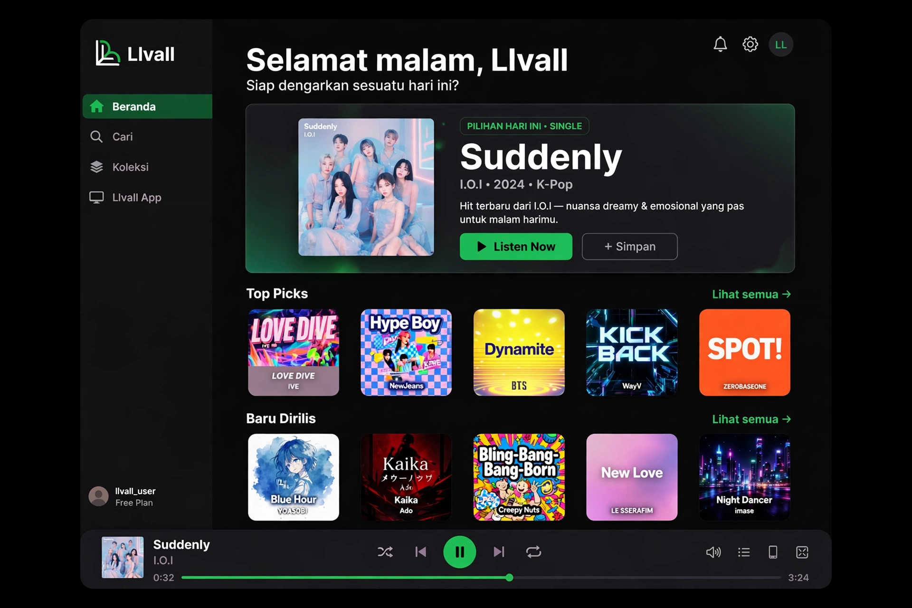
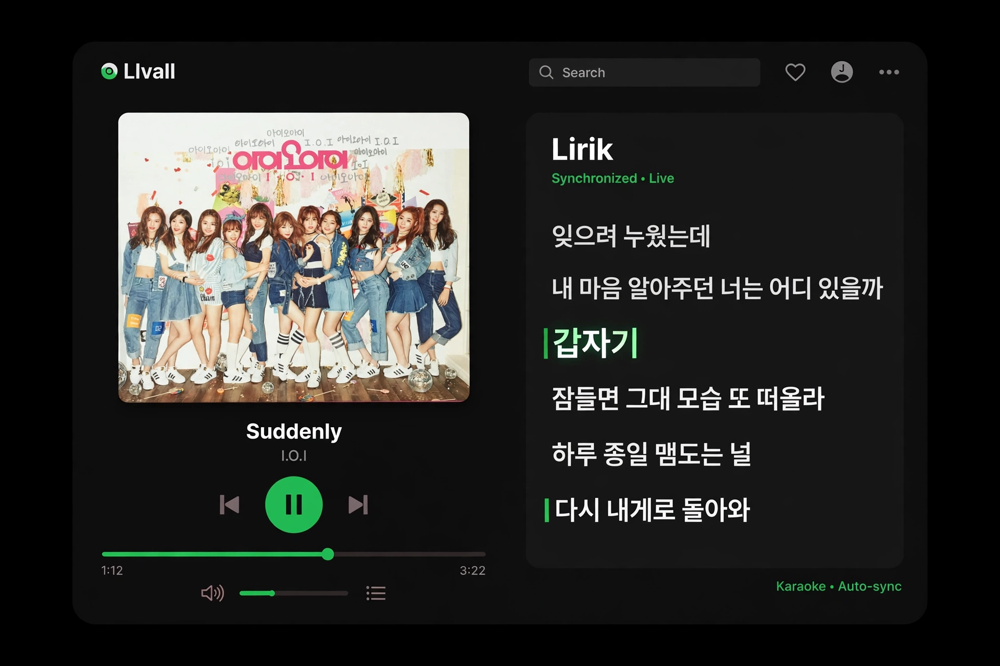
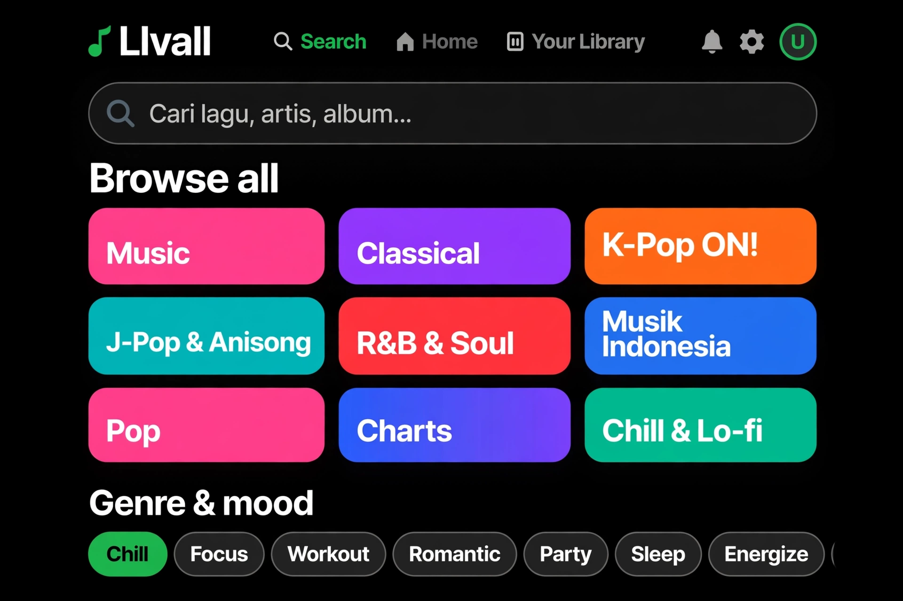
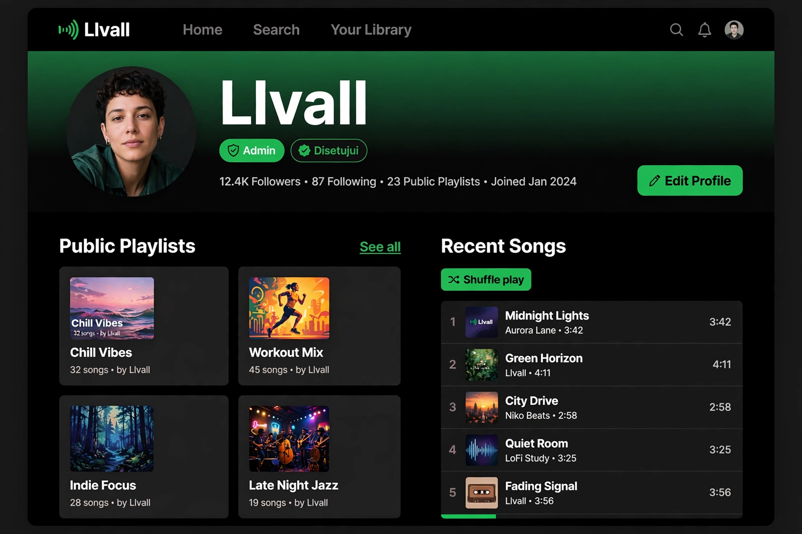

# 🎵 Llvall

**An elegant music app for Android — pure black, beautiful covers, full-track playback.**

*Full tracks. Background play. Synced lyrics & karaoke. Import from Spotify & YouTube Music.*

[⬇️ Download the APK](https://github.com/LlvallVeiz/llvall/releases/download/v1.0.0/llvall-v1.0.0.apk)

---

## ✨ Features

| | |
|---|---|
| 🎧 **Full-track playback** | Real, complete songs — not previews. |
| ▶️ **Background play** | Music keeps playing when you leave the app. |
| 🎤 **Lyrics & karaoke** | Synced line-by-line lyrics with word-by-word karaoke highlight. |
| 🔀 **Smart queue** | Up Next, shuffle, repeat, and radio-style autoplay. |
| 📥 **Import playlists** | Bring your Spotify & YouTube Music playlists in. |
| 🖤 **Pure-black design** | Elegant, Spotify-grade dark UI with beautiful covers. |
| 🔍 **Powerful search** | Find songs, artists, albums and playlists instantly. |

---

## 📸 Screenshots

> Screenshots are being added — the app speaks for itself below.

| Home | Now Playing |
|---|---|
|  |  |

| Search | Profile |
|---|---|
|  |  |

---

## ⬇️ Download & install

1. Download the APK: **[llvall-v1.0.0.apk](https://github.com/LlvallVeiz/llvall/releases/download/v1.0.0/llvall-v1.0.0.apk)** (~29 MB)
2. On your phone, allow **“Install unknown apps”** for your browser when asked.
3. Open the downloaded APK and tap **Install**.
4. Open **Llvall**, sign in with Google, and enjoy the music. 🎶

> **Note:** each new build is signed with a fresh debug keystore, so please **uninstall the previous version first** before installing a new one.

---

## 📱 Requirements

- Android 7.0+ (phone or tablet)
- Internet connection for streaming, lyrics and imports

---

## 📄 About the source code

Llvall is distributed as a ready-to-install APK only. The source code is not public.

---

**Llvall** — *putar musik favoritmu, full track.* 🖤

